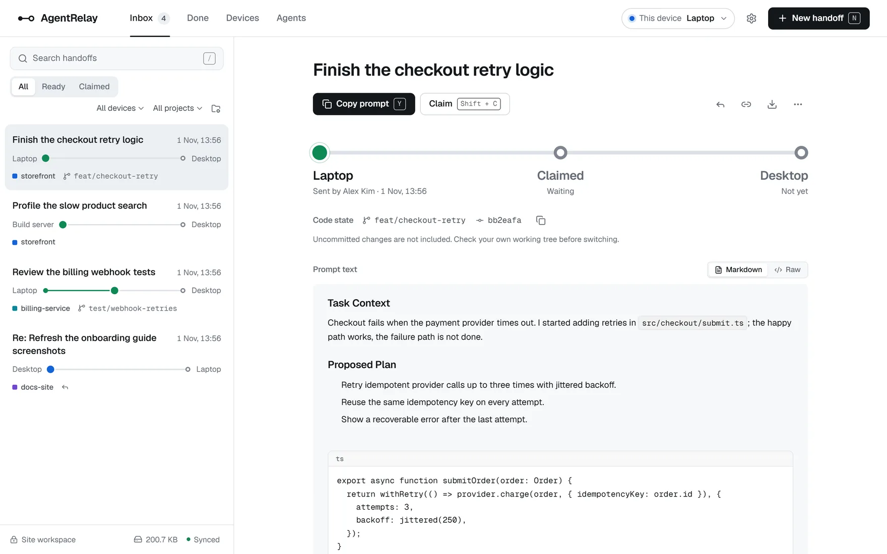
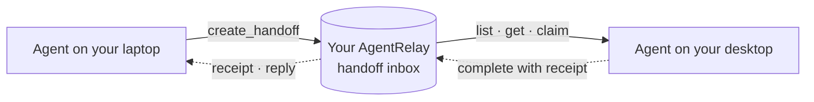
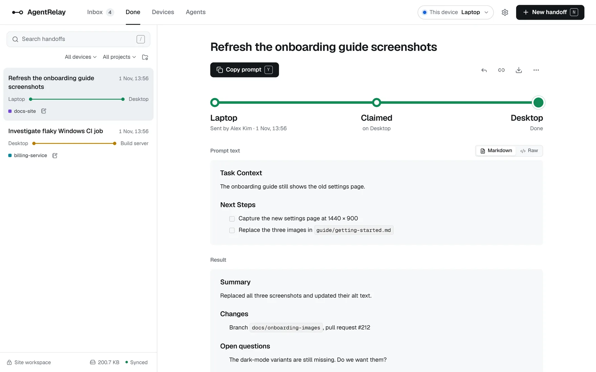
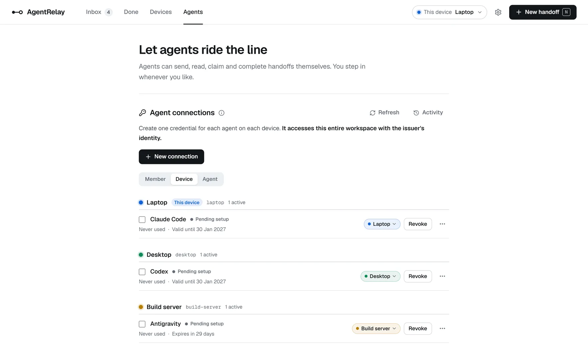
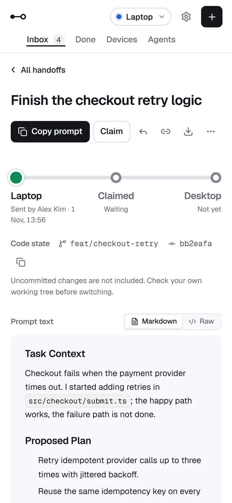
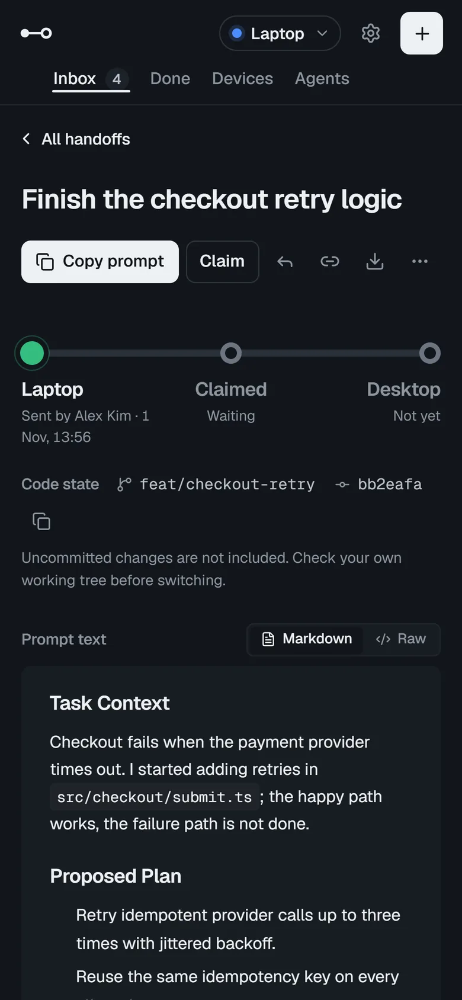

<div align="center">


# AgentRelay

**Hand work between your devices and coding agents, with full context, over MCP.**

A self-hosted prompt relay that runs on your own ChatGPT Site or Cloudflare account.<br>
Pick it up here, continue on the next device.

[](LICENSE)
[](https://modelcontextprotocol.io/)
[](https://workers.cloudflare.com/)
[](https://nodejs.org/)

**English** · [简体中文](README.zh-CN.md)

</div>

---

You stop working on your laptop and want to keep going on your desktop, or you want a different agent to pick up where another left off. Usually that means copying a prompt into a chat, a note or a message to yourself, and losing the formatting, the route and any record of who took it.

AgentRelay replaces that copy and paste. An agent sends a **handoff**: a complete Markdown prompt addressed from one device to another, with optional images, project and Git state. The agent on the receiving device asks what is waiting, claims it atomically and, when the work is done, sends a receipt back. Everything lives in a deployment you own: a Site in your ChatGPT account, or a Worker in your Cloudflare account behind Cloudflare Access. Your data never leaves it.

<picture>
  <source media="(prefers-color-scheme: dark)" srcset="docs/images/inbox-dark.webp">
  
</picture>

## How it works



1. **Send.** On one device, tell your agent "hand this off to Desktop". It packs the context, progress and next steps into a handoff and calls `create_handoff`.
2. **Receive.** On the other device, ask "any handoffs for me?". The agent lists what is waiting for that device and reads the prompt exactly as it was sent.
3. **Claim and finish.** The agent claims the handoff (`ready → claimed`), does the work and completes it (`claimed → done`) with a receipt that says what changed and what is still open. Every transition is version-checked, so two devices can never take the same task.

You can also read, send and manage handoffs from the web inbox in any browser. Nothing is pushed into a running agent: the receiver always asks, and a handoff is task context for review, never permission to act.

## Highlights

| Feature | What you get |
| :--- | :--- |
| **Five standard MCP tools** | `create_handoff`, `list_handoffs`, `get_handoff`, `claim_handoff` and `complete_handoff`, the same for every agent. Native clients sign in with the deployment; any agent can use a personal token. |
| **Exact prompts** | Up to 200,000 characters, stored and returned verbatim, with indentation and code blocks intact. |
| **Routes and claims** | Every handoff goes from a source device to a target device and moves through `ready → claimed → done` under optimistic concurrency control. |
| **Receipts and replies** | A completion can carry a Markdown receipt back to the sender. A reply goes the other way and joins the same thread. |
| **Images** | Up to 10 PNG, JPEG or WebP images per handoff, stored byte for byte in private R2 storage and delivered to agents as MCP image blocks. |
| **Git context** | The sender can attach its branch and commit. The receiver checks them against its own checkout before it claims anything. |
| **Devices and projects** | A registry of the machines you work on. Projects are created on first use from the repository name an agent sends. |
| **A calm web inbox** | A transit-map interface in English and Simplified Chinese, with light and dark themes, search, keyboard shortcuts, browser notifications and storage management. |
| **Optional sharing** | The accounts you trust, in the Site's Sharing settings or the Cloudflare Access policy, share one workspace with equal rights. |

## A closer look

**Receipts come back to the sender.** When the receiving agent completes a handoff, its receipt says what changed and what is still open, right under the original prompt.



**One connection per agent, per device.** The Agents page issues a personal credential for each agent, groups connections by device, and lets you move or revoke any of them.



**Works on a phone, in light or dark.** The same inbox adapts to small screens and follows your system theme.

<p align="center">
  
  &nbsp;&nbsp;
  
</p>

## Supported agents

| Agent | How it connects |
| :--- | :--- |
| ChatGPT and Codex (ChatGPT Sites) | The Site's own plugin at `/mcp`, with platform sign-in. No token, repository or Node.js. |
| Claude Code, Codex and ChatGPT (Cloudflare) | Native MCP at `/mcp`, signed in with Google through Cloudflare Access. No token or local client. See [native MCP clients](docs/guides/cloudflare-deployment.md#native-mcp-clients). |
| Codex | Personal Agent Token at `/api/agent/mcp`, through a header helper or the local bridge. See the [Codex guide](docs/guides/codex-direct-connection.md). |
| Claude Code | Personal Agent Token, through a header helper or the local bridge. See the [Claude Code guide](docs/guides/claude-code-setup.md). |
| Antigravity | Local bridge. See the [Antigravity guide](docs/guides/antigravity-connection.md). |
| DeepSeek Harness | Local bridge. See the [DeepSeek Harness guide](docs/guides/deepseek-harness-connection.md). |

The server speaks only standard MCP and never changes its behavior for a particular client. Agent-specific details live in connection profiles, and agents that cannot send custom headers connect through one generic [local bridge](docs/guides/local-bridge.md). Which paths have passed live acceptance is listed in the [known gaps](PRODUCT.md#vision).

## Get started

### 1. Choose where to run it

AgentRelay runs as one private deployment that you own. Both options run the same app: the inbox, devices, agents and handoffs work the same way. They differ in who hosts it, how people sign in and how agents connect.

| | ChatGPT Sites | Your Cloudflare account |
| :--- | :--- | :--- |
| **You need** | A ChatGPT account that can use [Sites](https://learn.chatgpt.com/docs/sites), and Codex with the Sites plugin | A Cloudflare account, and a Google Cloud project for the sign-in client |
| **Setup** | Paste one request into Codex; it deploys and prints the URL | About 30 minutes: two Wrangler commands, one deploy command and a one-time Cloudflare Access setup in the dashboard |
| **Cost** | Whatever Sites costs on your ChatGPT plan | The Free plan works for trying it out; Workers Paid ($5 a month) is recommended for daily use |
| **Who can sign in** | The accounts you add in the Site's Sharing settings | The Google accounts you list in the Access policy |
| **Agents with a token** | Agent Token, plus the Site's gateway token saved once per device | Agent Token only |
| **Agents without a token** | The Site's own ChatGPT and Codex plugin | Claude Code, Codex, ChatGPT and claude.ai, signed in with Google |
| **Updating** | Paste the same request again | `git pull`, `npm ci`, `npm run deploy:cloudflare` |
| **Status** | Verified live on an earlier build | In development: verified in a test deployment on Workers Free |

**Choose ChatGPT Sites** if you already work in Codex with the Sites plugin and want Codex to do the deployment for you.
**Choose Cloudflare** if you have no Sites access, want the deployment in your own Cloudflare account, or want Claude Code, Codex, ChatGPT or claude.ai to connect by signing in instead of with a token.

### 2. Deploy

- **ChatGPT Sites:** follow [Deploy to ChatGPT Sites](docs/guides/first-deployment.md). You clone this repository and paste [the deployment request](docs/guides/first-deployment.md#2-deploy) into Codex; it creates your private Site.
- **Cloudflare:** follow [Deploy to Cloudflare](docs/guides/cloudflare-deployment.md). One command deploys the Worker, and Cloudflare Access lets in only the people you list.

### 3. Connect your devices and hand off

On each device whose agent connects with a token you need Git and Node.js `>=22.13.0`; no `npm install` is needed. Agents that connect without a token need neither.

1. **Connect this device.** Open AgentRelay. Its setup checklist asks which device this is, then opens the connection wizard: a token connection set up with one command, or a client that connects without a token. On ChatGPT Sites the first token connection on a device also needs the Site's [gateway token](docs/guides/agent-connections.md#the-gateway-token).
2. **Connect the next device.** Clone the repository there too, open AgentRelay and repeat step 1.
3. **Hand off.** Tell the agent on one device "hand this off to Desktop". On the other, ask "any handoffs for me?".

Notifications, sharing and images come after the first handoff. Each deployment guide walks through them.

## Security model

- **One deployment, one workspace.** Every query is scoped to a workspace resolved on the server, from the platform's sign-in (a Site's, or a verified Cloudflare Access token) or from the SHA-256 hash of an Agent Token. The client never supplies it.
- **Text is data.** Prompts, receipts, replies, Git context and images are untrusted input. AgentRelay stores and shows them; it never renders them as HTML and never executes them. Reading or claiming a handoff grants no authority.
- **Pull, not push.** Agents ask for their handoffs. Nothing reaches a running agent on its own.
- **Credentials stay local.** The local client keeps each Agent Token, and on ChatGPT Sites the Site's gateway token, in the operating system's credential store. Configuration files hold only paths and connection ids, and every token can be revoked from the web app.

The complete rules are in [security invariants](docs/reference/security-invariants.md). To report a vulnerability, follow [SECURITY.md](SECURITY.md).

## Documentation

| Using AgentRelay | Reference | Contributing |
| :--- | :--- | :--- |
| [Deploy to ChatGPT Sites](docs/guides/first-deployment.md) | [MCP protocol and agent guidelines](docs/reference/mcp-protocol.md) | [Local development and verification](docs/guides/development.md) |
| [Deploy to Cloudflare](docs/guides/cloudflare-deployment.md) | [Devices and connections](docs/reference/devices-and-connections.md) | [Contributing](CONTRIBUTING.md) |
| [Agent connections](docs/guides/agent-connections.md) | [Projects](docs/reference/projects.md) | [Repository rules for agents](AGENTS.md) |
| [Image handoffs](docs/guides/image-handoffs.md) | [Images](docs/reference/images.md) | [Design specification](design/DESIGN.md) |
| [Browser notifications](docs/guides/notifications.md) | [Receipts and threads](docs/reference/receipts-and-threads.md) | [System overview diagram](docs/architecture/agentrelay-system-overview.html) |
| [Storage management](docs/guides/storage-management.md) | [Git context](docs/reference/git-context.md) | [Product brief](PRODUCT.md) |
| [Keyboard shortcuts](docs/guides/keyboard-shortcuts.md) | [Inbox list](docs/reference/inbox-list.md) | [Architecture decisions](docs/architecture/decisions/0002-standalone-cloudflare-deployment.md) |
| [Local bridge](docs/guides/local-bridge.md) | [Shared workspace](docs/reference/shared-workspace.md) | |
| | [Security invariants](docs/reference/security-invariants.md) | |

The system overview is a standalone HTML page. Download it and open it in a browser to explore how the entry points, the Worker's layers and its storage connect, with each component linked to the source lines it was drawn from.

## Development

AgentRelay is a Next.js 16 application built with [Vinext](https://github.com/cloudflare/vinext) for Cloudflare Workers, with D1 (SQLite, through Drizzle ORM) for records and R2 for images. Development and CI use the Node.js version in `.node-version`.

```bash
npm ci
npm run build
npm run db:migrate:local
npm run dev          # http://127.0.0.1:5173
```

Before you submit a change, run the checks listed in [CONTRIBUTING.md](CONTRIBUTING.md). The [development guide](docs/guides/development.md) covers checkout-local temporary directories, migrations, the built-Worker integration suites, browser tests and a map of the code.

## Project status

AgentRelay is under active development. CI runs lint, type and architecture checks, the unit tests, a production build, dependency audits and the built-Worker integration suites on Ubuntu and Windows. Browser tests run locally. Hosted acceptance of the current build, a standalone Cloudflare deployment set up from its guide, macOS and Linux client setup, and some agent paths are still open; the [known gaps](PRODUCT.md#vision) list exactly what has and has not been verified.

## License

AgentRelay's original source is released under the [MIT License](LICENSE). The architecture viewer includes Archify code and the JetBrains Mono font under their [own licenses and notices](docs/architecture/archify-notices/NOTICE). Dependencies keep their own licenses; some `sharp` platform packages include LGPL components, so review their terms before redistributing dependencies or compiled binaries.
