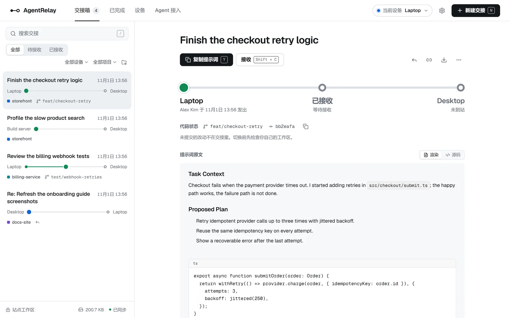
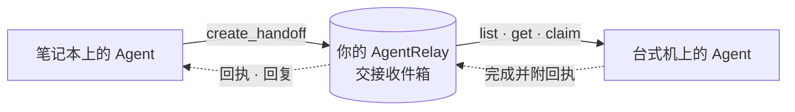
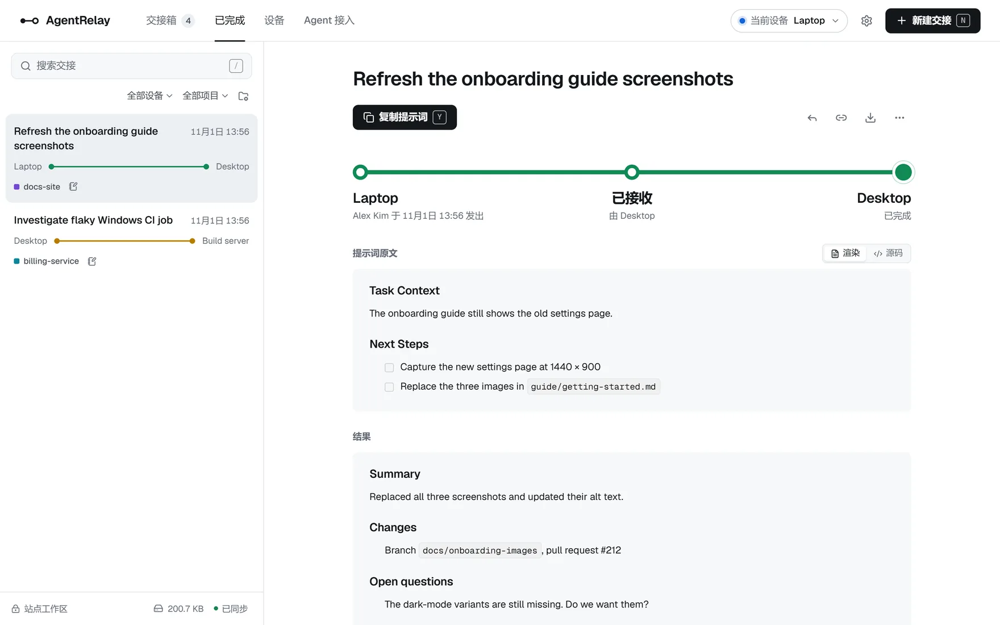
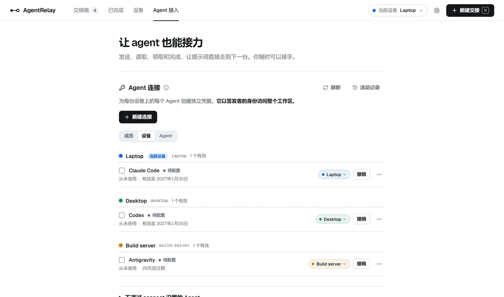
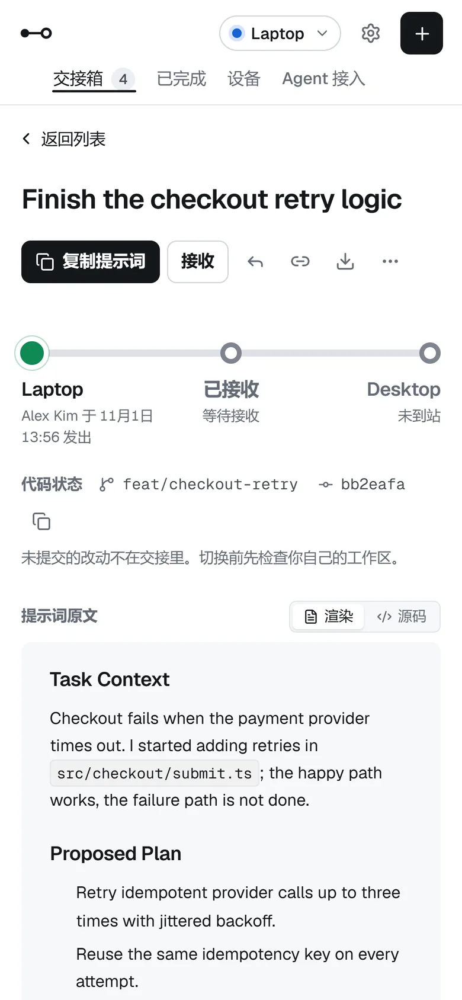
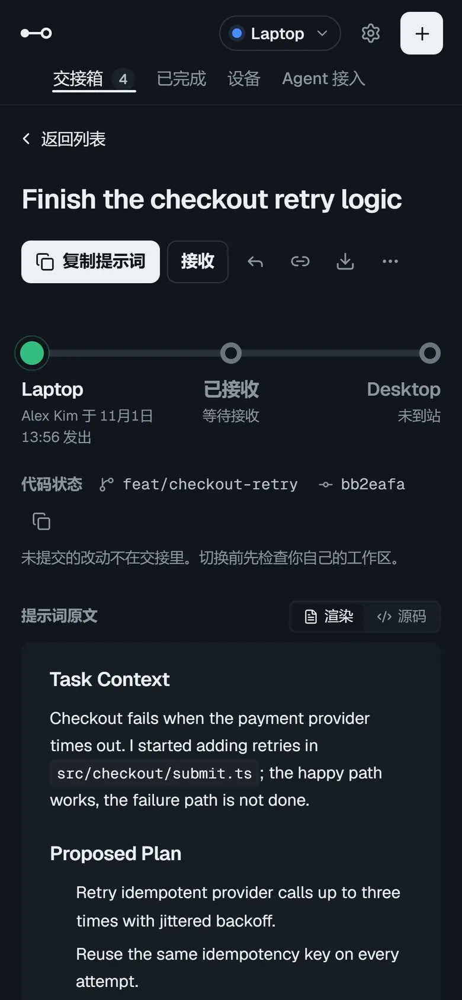

<div align="center">


# AgentRelay

**在你的设备和编程 Agent 之间交接工作，完整上下文，经由 MCP。**

运行在你自己的 ChatGPT Site 或 Cloudflare 账号上的自托管提示词中继。<br>
这里放下，下一台设备接着做。

[](LICENSE)
[](https://modelcontextprotocol.io/)
[](https://workers.cloudflare.com/)
[](https://nodejs.org/)

[English](README.md) · **简体中文**

</div>

---

你在笔记本上停下手里的工作，想到台式机上接着做；或者想让另一个 Agent 接手前一个没做完的事。通常这意味着把提示词复制到聊天窗口、笔记或发给自己的消息里，格式丢了，也说不清是从哪台设备发往哪台、谁已经接手。

AgentRelay 取代的就是这一步复制粘贴。Agent 发出一份**交接（handoff）**：一段完整的 Markdown 提示词，注明从哪台设备发往哪台设备，可以附带图片、所属项目和 Git 状态。接收设备上的 Agent 查询有哪些待处理的交接，原子地认领，做完后把回执发回去。所有数据都存放在你自己的部署里：ChatGPT 账号中的 Site，或你的 Cloudflare 账号中、由 Cloudflare Access 保护的 Worker，不会离开它。

<picture>
  <source media="(prefers-color-scheme: dark)" srcset="docs/images/inbox-zh-dark.webp">
  
</picture>

## 工作方式



1. **发送。** 在一台设备上对 Agent 说"把这个交接给 Desktop"。它会把上下文、进度和下一步整理成一份交接，调用 `create_handoff`。
2. **接收。** 在另一台设备上问"有给我的交接吗？"。Agent 会列出发往这台设备的待处理交接，读到的提示词与发送时一字不差。
3. **认领并完成。** Agent 认领交接（`ready → claimed`），完成工作后标记完成（`claimed → done`），并附上回执，说明改了什么、还有哪些待定。每次状态变更都带版本校验，两台设备不可能同时拿走同一个任务。

你也可以在任意浏览器的网页收件箱里查看、发送和管理交接。AgentRelay 从不向正在运行的 Agent 推送任何东西，总是由接收方主动查询。交接只是供审阅的任务上下文，从不代表执行授权。

## 亮点

| 功能 | 说明 |
| :--- | :--- |
| **五个标准 MCP 工具** | `create_handoff`、`list_handoffs`、`get_handoff`、`claim_handoff` 和 `complete_handoff`，对所有 Agent 都一样。原生客户端使用部署自身的登录，任何 Agent 都可以使用个人令牌。 |
| **原样保留提示词** | 最多 200,000 个字符，按原样存储和返回，缩进和代码块保持不变。 |
| **路由与认领** | 每份交接都从源设备发往目标设备，在乐观并发控制下经历 `ready → claimed → done`。 |
| **回执与回复** | 完成时可以附一份 Markdown 回执发回给发送方；回复则反方向发出，并归入同一个线程。 |
| **图片** | 每份交接最多 10 张 PNG、JPEG 或 WebP 图片，原样存放在私有的 R2 存储中，以 MCP image 块交给 Agent。 |
| **Git 上下文** | 发送方可以附上所在分支和提交，接收方在认领前先与自己的工作区比对。 |
| **设备与项目** | 登记你使用的每台机器。项目在首次使用时按 Agent 发来的仓库名自动创建。 |
| **安静的网页收件箱** | 地铁线路图风格的界面，支持英文和简体中文、浅色和深色主题、搜索、键盘快捷键、浏览器通知和存储管理。 |
| **可选共享** | 你信任的账号（在 Site 的 Sharing 设置或 Cloudflare Access 策略中添加）以同等权限共享同一个工作区。 |

## 界面一览

**回执会回到发送方。** 接收方的 Agent 完成交接时附上的回执，会显示在原提示词下方，说明改了什么、还有哪些待定。



**每个设备上的每个 Agent 各用一个连接。** Agent 接入页面为每个 Agent 签发个人凭据，按设备分组显示连接，可以随时移动或撤销。



**手机上也能用，浅色深色都支持。** 同一个收件箱会适配小屏幕，并跟随系统主题。

<p align="center">
  
  &nbsp;&nbsp;
  
</p>

## 支持的 Agent

| Agent | 连接方式 |
| :--- | :--- |
| ChatGPT 和 Codex（ChatGPT Sites） | 通过 Site 自带的插件连接 `/mcp`，使用平台登录，无需令牌、仓库或 Node.js。 |
| Claude Code、Codex 和 ChatGPT（Cloudflare） | 原生 MCP 连接 `/mcp`，通过 Cloudflare Access 用 Google 登录，无需令牌或本地客户端。参见[原生 MCP 客户端](docs/guides/cloudflare-deployment.md#native-mcp-clients)。 |
| Codex | 个人 Agent Token 连接 `/api/agent/mcp`，经由 header helper 或本地桥接。见 [Codex 指南](docs/guides/codex-direct-connection.md)。 |
| Claude Code | 个人 Agent Token，经由 header helper 或本地桥接。见 [Claude Code 指南](docs/guides/claude-code-setup.md)。 |
| Antigravity | 本地桥接。见 [Antigravity 指南](docs/guides/antigravity-connection.md)。 |
| DeepSeek Harness | 本地桥接。见 [DeepSeek Harness 指南](docs/guides/deepseek-harness-connection.md)。 |

服务端只使用标准 MCP，从不因调用方是哪个 Agent 而改变行为。各 Agent 的差异放在连接配置（profile）里，无法发送自定义请求头的 Agent 统一通过一个通用的[本地桥接](docs/guides/local-bridge.md)连接。哪些连接方式已通过实机验收，见[已知差距](PRODUCT.md#vision)。

## 快速开始

### 1. 选择部署位置

AgentRelay 以一个归你所有的私有部署运行。两种方式运行的是同一个应用：收件箱、设备、Agent 和交接的用法完全相同。区别在于由谁托管、成员如何登录，以及 Agent 如何连接。

| | ChatGPT Sites | 你自己的 Cloudflare 账号 |
| :--- | :--- | :--- |
| **你需要** | 一个可以使用 [Sites](https://learn.chatgpt.com/docs/sites) 的 ChatGPT 账号，以及安装了 Sites 插件的 Codex | 一个 Cloudflare 账号，以及一个用于创建登录客户端的 Google Cloud 项目 |
| **设置** | 把一段请求粘贴给 Codex，它完成部署并给出网址 | 约 30 分钟：两条 Wrangler 命令、一条部署命令，以及在控制台中一次性设置 Cloudflare Access |
| **费用** | 按你的 ChatGPT 套餐中 Sites 的价格 | 试用时 Free 套餐即可；日常使用推荐 Workers Paid（每月 5 美元） |
| **谁可以登录** | 你在 Site 的 Sharing 设置中添加的账号 | 你在 Access 策略中列出的 Google 账号 |
| **使用令牌的 Agent** | Agent Token，外加每台设备保存一次的 Site gateway token | 只需 Agent Token |
| **无需令牌的 Agent** | Site 自带的 ChatGPT 和 Codex 插件 | 用 Google 登录的 Claude Code、Codex、ChatGPT 和 claude.ai |
| **更新** | 再次粘贴同一段请求 | `git pull`、`npm ci`、`npm run deploy:cloudflare` |
| **状态** | 已在较早的版本上完成线上验证 | 开发中：已在 Workers Free 的测试部署中验证 |

**选择 ChatGPT Sites**：如果你已经在用带 Sites 插件的 Codex，并希望由 Codex 替你完成部署。
**选择 Cloudflare**：如果你没有 Sites 权限、希望部署在自己的 Cloudflare 账号里，或者希望 Claude Code、Codex、ChatGPT 或 claude.ai 通过登录而不是令牌来连接。

### 2. 部署

- **ChatGPT Sites：** 按照[部署到 ChatGPT Sites](docs/guides/first-deployment.md)操作。克隆本仓库，把[部署请求](docs/guides/first-deployment.md#2-deploy)粘贴给 Codex，它会创建你的私有 Site。
- **Cloudflare：** 按照[部署到 Cloudflare](docs/guides/cloudflare-deployment.md)操作。一条命令部署 Worker，Cloudflare Access 只让你列出的人登录。

### 3. 连接设备并开始交接

在每台通过令牌连接 Agent 的设备上，需要 Git 和 Node.js `>=22.13.0`，无需 `npm install`。无需令牌就能连接的 Agent 两者都不需要。

1. **连接这台设备。** 打开 AgentRelay。设置清单会先问这是哪台设备，然后打开连接向导：一条命令完成的令牌连接，或者无需令牌的客户端。在 ChatGPT Sites 上，一台设备上的第一个令牌连接还需要 Site 的 [gateway token](docs/guides/agent-connections.md#the-gateway-token)。
2. **连接下一台设备。** 在那台设备上同样克隆本仓库，打开 AgentRelay，重复第 1 步。
3. **开始交接。** 对一台设备上的 Agent 说"把这个交接给 Desktop"，在另一台上问"有给我的交接吗？"。

通知、共享和图片都可以在第一次交接之后再设置，两份部署指南中都有逐项说明。

## 安全模型

- **一个部署就是一个工作区。** 每个查询都限定在服务端解析出的工作区内：来自平台登录（Site 的登录，或经过校验的 Cloudflare Access 令牌），或来自 Agent Token 的 SHA-256 哈希，从不由客户端提供。
- **文本只是数据。** 提示词、回执、回复、Git 上下文和图片都是不可信输入。AgentRelay 只负责存储和展示，从不把它们当作 HTML 渲染，也从不执行。读取或认领一份交接不授予任何权限。
- **只拉取，不推送。** Agent 主动查询自己的交接，不会有东西自行进入正在运行的 Agent。
- **凭据留在本地。** 本地客户端把每个 Agent Token（在 ChatGPT Sites 上还有 Site 的 gateway token）存放在操作系统的凭据存储中，配置文件里只有路径和连接 id，每个令牌都可以在网页中撤销。

完整规则见[安全不变量](docs/reference/security-invariants.md)。报告漏洞请按 [SECURITY.md](SECURITY.md) 的说明进行。

## 文档

以下文档均为英文。

| 使用 | 参考 | 参与开发 |
| :--- | :--- | :--- |
| [部署到 ChatGPT Sites](docs/guides/first-deployment.md) | [MCP 协议与 Agent 规范](docs/reference/mcp-protocol.md) | [本地开发与验证](docs/guides/development.md) |
| [部署到 Cloudflare](docs/guides/cloudflare-deployment.md) | [设备与连接](docs/reference/devices-and-connections.md) | [贡献指南](CONTRIBUTING.md) |
| [Agent 连接](docs/guides/agent-connections.md) | [项目](docs/reference/projects.md) | [面向 Agent 的仓库规则](AGENTS.md) |
| [图片交接](docs/guides/image-handoffs.md) | [图片](docs/reference/images.md) | [设计规范](design/DESIGN.md) |
| [浏览器通知](docs/guides/notifications.md) | [回执与线程](docs/reference/receipts-and-threads.md) | [系统架构图](docs/architecture/agentrelay-system-overview.html) |
| [存储管理](docs/guides/storage-management.md) | [Git 上下文](docs/reference/git-context.md) | [产品简介](PRODUCT.md) |
| [键盘快捷键](docs/guides/keyboard-shortcuts.md) | [收件箱列表](docs/reference/inbox-list.md) | [架构决策](docs/architecture/decisions/0002-standalone-cloudflare-deployment.md) |
| [本地桥接](docs/guides/local-bridge.md) | [共享工作区](docs/reference/shared-workspace.md) | |
| | [安全不变量](docs/reference/security-invariants.md) | |

系统架构图是一个独立的 HTML 页面。下载后在浏览器中打开，可以查看入口、Worker 各层与存储之间如何连接，每个组件都链接到绘制它所依据的源码行。

## 开发

AgentRelay 是一个用 [Vinext](https://github.com/cloudflare/vinext) 构建、运行在 Cloudflare Workers 上的 Next.js 16 应用，记录存放在 D1（SQLite，通过 Drizzle ORM），图片存放在 R2。开发和 CI 使用 `.node-version` 中指定的 Node.js 版本。

```bash
npm ci
npm run build
npm run db:migrate:local
npm run dev          # http://127.0.0.1:5173
```

提交改动前，请运行 [CONTRIBUTING.md](CONTRIBUTING.md) 中列出的检查。[开发指南](docs/guides/development.md)介绍了工作区内的临时目录、数据库迁移、针对构建产物 Worker 的集成测试、浏览器测试，以及代码地图。

## 项目状态

AgentRelay 仍在积极开发中。CI 在 Ubuntu 和 Windows 上运行 lint、类型与架构检查、单元测试、生产构建、依赖审计，以及针对构建产物 Worker 的集成测试；浏览器测试在本地运行。当前版本在托管环境中的验收、按指南完成的 Cloudflare 独立部署、macOS 与 Linux 上的客户端安装，以及部分 Agent 的连接方式仍待验证，[已知差距](PRODUCT.md#vision)中逐项列出了哪些已验证、哪些尚未验证。

## 许可证

AgentRelay 的原创源码以 [MIT License](LICENSE) 发布。架构图查看器包含 Archify 代码和 JetBrains Mono 字体，它们适用[各自的许可证和声明](docs/architecture/archify-notices/NOTICE)。依赖项保留各自的许可证；部分 `sharp` 平台包含有 LGPL 组件，再分发依赖或编译后的二进制文件前，请先确认相应条款。

如中英文内容有出入，以英文版 [README.md](README.md) 为准。
